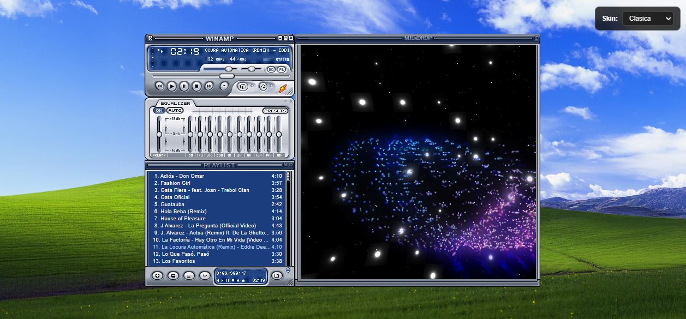
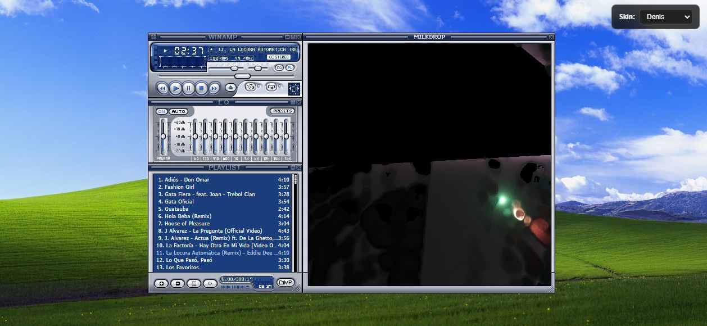

## Estructura del proyecto

```text
webamp/
├── index.html
├── style.css
├── script.js
├── canciones/
│   ├── cancion1.mp3
│   ├── cancion2.mp3
│   └── cancion3.mp3
├── imagenes/
│   ├── icon.jpg
│   └── fondo.jpg
```

## Instalación

1. Descarga o clona el proyecto.
2. Coloca tus archivos MP3 en la carpeta `canciones/`.
3. Abre `index.html` en tu navegador o ejecuta el proyecto mediante un servidor web.
5. Selecciona una canción y disfruta de tu música.

## Licencia

Proyecto personal y educativo. Utiliza únicamente canciones, imágenes y recursos que tengas permiso para distribuir.

# Vista Previa



